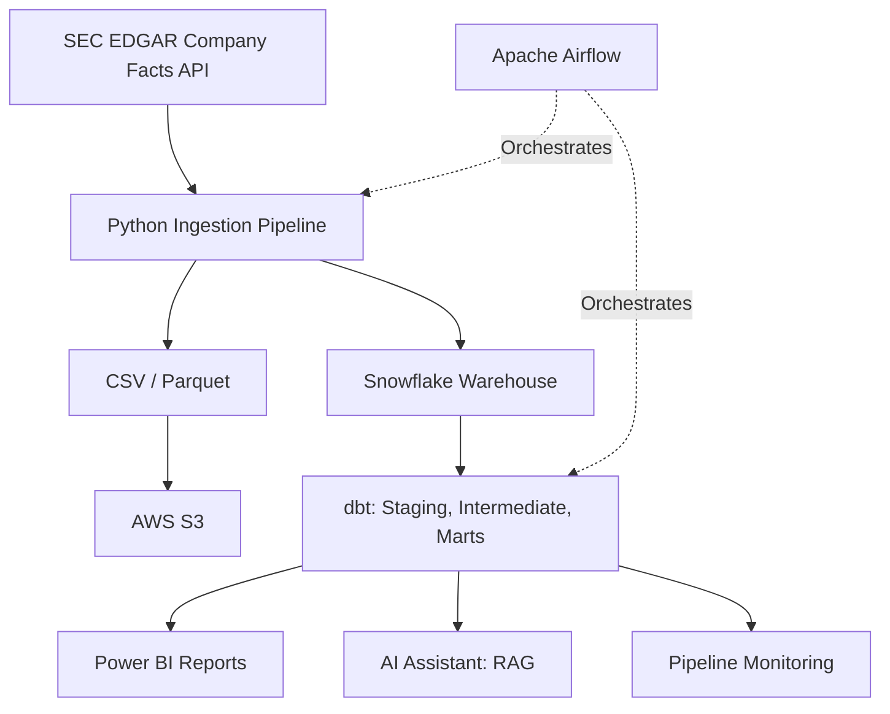
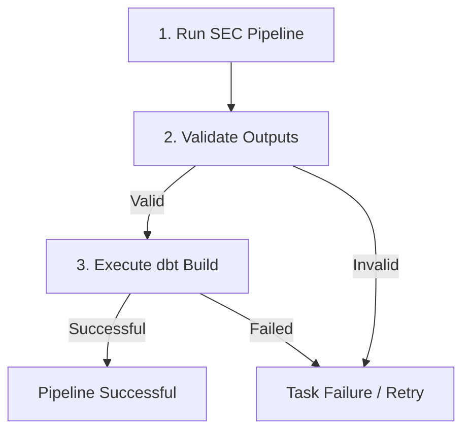

# AI Capital Intelligence

An end-to-end financial intelligence platform that transforms public SEC financial filings into structured, governed analytics, company comparisons, revenue forecasts, anomaly detection, financial risk indicators, and AI-assisted explanations.

The project demonstrates a complete data and analytics workflow using Python, AWS S3, Snowflake, dbt, Apache Airflow, Power BI, and a locally hosted retrieval-augmented AI application.

## Project Overview

**Business objective:** Build a repeatable financial intelligence platform that helps analysts explore the reported financial performance, cash flows, trends, and selected financial risk indicators of major technology companies.

**Companies covered:**

- Amazon (AMZN)
- Microsoft (MSFT)
- Alphabet (GOOGL)
- Meta Platforms (META)

**Primary source:** SEC EDGAR Company Facts API.

**Important scope clarification:** The platform analyzes company-wide reported financial information. It does not claim to isolate AI-specific revenue, expenditure, profitability, or return on investment.

## Business Problems

Financial information is published across filings and reporting periods. Analysts need to:

- Normalize financial observations from different companies.
- Compare financial performance across reporting periods.
- Understand cash-flow movements and reporting limitations.
- Identify unusual financial patterns for further investigation.
- Examine historical revenue and analytical forecasts.
- Access governed analytical results through dashboards and an AI assistant.

This project addresses these requirements through a reproducible data pipeline and a set of analytical models.

## Architecture

```text
                 SEC EDGAR Company Facts
                           |
                           v
                  Python Data Pipeline
                Extraction and Normalization
                           |
                 +---------+---------+
                 |                   |
                 v                   v
              AWS S3             Snowflake
                 ^                   ^
                 |                   |
           CSV / Parquet      Direct write_pandas()
                 ^                   ^
                 +--------+----------+
                          |
                   Python Pipeline
                          |
                 RAW -> STAGING -> ANALYTICS
                          |
                          v
                         dbt
             Transformation and Data Testing
                          |
                          v
                Governed Analytics Marts
                          |
              +-----------+-----------+
              |           |           |
              v           v           v
           Power BI     AI / RAG   Monitoring
          Dashboards   Application  and Logs

              Apache Airflow Orchestration
          SEC Pipeline -> Validation -> dbt Build
```

## Technology Stack

| Layer | Technologies |
|---|---|
| Data source | SEC EDGAR Company Facts API |
| Ingestion | Python, Pandas, NumPy |
| Storage | CSV, Parquet, AWS S3 |
| Data warehouse | Snowflake |
| Transformation | dbt Core, SQL |
| Orchestration | Apache Airflow, Docker |
| Data quality | Pytest, dbt tests |
| Analytics | Power BI |
| AI | Ollama, Llama 3.2 3B |
| Retrieval | ChromaDB, RAG |
| Application | FastAPI, Streamlit |
| Version control and CI | Git, GitHub Actions |

## Data Engineering Pipeline

The Python pipeline extracts financial observations from SEC Company Facts, normalizes the records, and generates processed CSV and Parquet datasets.

The pipeline supports cloud storage and Snowflake loading.

### Snowflake data layers

- **RAW:** Ingested financial observations.
- **STAGING:** Standardized SEC observations and eligibility filtering.
- **ANALYTICS:** Analytical source views.
- **DBT_DEV:** Transformed analytical models.

The latest previously recorded extraction contained **4,529 observations** across the four companies. This is a recorded pipeline result, not a claim that every subsequent execution produces an identical row count.

### Financial metrics

The principal metrics include:

- Revenue
- Operating income
- Net income
- Capital expenditure
- Operating cash flow

## dbt Analytics

The dbt project contains:

- 20 models
- 2 seeds
- 2 sources
- 72 data tests

Analytical capabilities include:

- Canonical financial metric selection.
- Filing evidence validation.
- Quarterly reporting-period alignment.
- Cash-flow derivation.
- Company performance analysis.
- Peer comparison and revenue ranking.
- Revenue forecasting.
- Financial anomaly detection.
- Financial risk indicators.
- Pipeline execution monitoring.

### Cash-flow accounting

Quarterly cash-flow derivation supports:

- Q2 = First-half cumulative value - Q1
- Q3 = Nine-month cumulative value - First-half cumulative value
- Q4 = Annual cumulative value - Nine-month cumulative value

Reported quarterly values are preferred when available.

**Accounting limitation:** CAPEX reporting-basis approval remains unresolved. `FREE_CASH_FLOW` is intentionally NULL where the basis is not approved. `FREE_CASH_FLOW_CANDIDATE` represents an arithmetic candidate and must not be presented as approved official free cash flow.

### Latest verified dbt build

The latest integrated dbt build ran as part of the successful scheduled Airflow execution on 28 November 2026.

| Build component | Count |
|---|---:|
| Seeds | 2 |
| Table models | 5 |
| View models | 15 |
| Data tests | 72 |
| Successful build steps | 94 |
| Warnings | 0 |
| Errors | 0 |
| Skipped | 0 |

The dbt log reported:

`PASS=94 WARN=0 ERROR=0 SKIP=0 NO-OP=0 TOTAL=94`

The dbt build completed in approximately **7 minutes and 20 seconds**.

**Interpretation:** 94 is the total successful dbt build-step count, not the number of data tests. The project contains 72 data tests.

## Apache Airflow Orchestration

DAG: `aci_sec_financial_pipeline`

The DAG orchestrates three dependent tasks:

1. `run_sec_pipeline` — executes SEC extraction and processing.
2. `validate_pipeline_outputs` — validates generated CSV and Parquet outputs.
3. `run_dbt_build` — executes the dbt build and associated tests.

### Latest verified integrated execution

**Execution date:** 28 November 2026
**DAG run ID:** `scheduled__2026-11-27T18:30:00+00:00`
**Final status:** SUCCESS
**Total duration:** Approximately 13 minutes 35 seconds

| Task | Status |
|---|---|
| `run_sec_pipeline` | SUCCESS |
| `validate_pipeline_outputs` | SUCCESS |
| `run_dbt_build` | SUCCESS |

All three tasks completed successfully in the same scheduled DAG run.

**Retry and recovery evidence:** The initial SEC API request encountered a temporary network connectivity failure inside the Airflow container. Airflow placed the task in its retry state. Connectivity subsequently recovered, and the automatic retry completed successfully. The scheduler connectivity check returned HTTP 200 with 4,554,378 response bytes. Downstream output validation and the dbt build then succeeded.

No manual task clearing or DAG code change was required for this recovery.

The DAG includes task-level execution timeouts, retries, and an overall DAG-run timeout.

Airflow is configured through Docker Compose. The local development interface is available at `http://localhost:8181` when the services are running.

## Power BI Dashboard

The repository includes `AI_Capital_Intelligence.pbix`.

The report contains seven pages:

1. Financial Performance
2. Company Comparison
3. Cash Flow Analysis
4. Revenue Forecasting
5. Financial Anomalies
6. Financial Risk
7. Settings & Information

The report uses Snowflake analytical models as its data source.

**Deployment status:** The Power BI Desktop report is available locally and included in the repository. Power BI Service accessibility and public cloud deployment have not been verified. Fabric onboarding was blocked by the available personal Microsoft account.

## AI Financial Intelligence

The local AI application combines language-model inference, vector retrieval, and controlled access to Snowflake analytical data.

### Components

- Ollama with Llama 3.2 3B.
- ChromaDB vector retrieval.
- Financial assistant and retrieval modules.
- FastAPI service.
- Streamlit interface.
- Snowflake analytical mart integration.

The application uses a hybrid retrieval approach involving Snowflake and ChromaDB.

### Governed analytical access

The Snowflake connector restricts analytical queries to six approved marts:

- `MART_COMPANY_PERFORMANCE`
- `MART_COMPANY_COMPARISON`
- `MART_REVENUE_FORECAST`
- `MART_CASH_FLOW_ANALYSIS`
- `MART_FINANCIAL_ANOMALIES`
- `MART_FINANCIAL_RISK_INDICATORS`

All six marts were successfully queried during a previous integration validation.

The assistant is designed to use approved analytical context rather than invent financial figures or present unsupported calculations as facts.

**Deployment status:** Local Ollama inference and application components have been tested. A publicly hosted AI application has not been verified.

## Validation and Quality Assurance

Previously recorded validation evidence includes:

| Validation | Recorded result |
|---|---|
| Python tests | 41 passed |
| Python compilation | Passed |
| Dependency check | No broken requirements |
| dbt models | 20 models |
| dbt data tests | 72 tests |
| Latest integrated dbt build | 94 PASS, 0 WARN, 0 ERROR, 0 SKIP |
| Latest scheduled Airflow run (28 November 2026) | All 3 tasks successful, including automatic retry recovery |
| Ollama inference | Passed |
| Snowflake integration | Six approved marts queried successfully |
| SEC extraction | 4,529 observations in a recorded run |

The Python test count and other integration results above are separately recorded validation results; they should not be interpreted as tests executed during the 28 November Airflow run.

## Repository Structure

```text
AI-Capital-Intelligence/
|
+-- .github/                 GitHub workflows
+-- data/                    Processed and supporting datasets
+-- dbt/                     dbt project, models, tests and seeds
+-- deliverables/             Generated project presentation and report
+-- docs/                    Project and technical documentation
+-- orchestration/
|   +-- airflow/
|       +-- dags/             Airflow DAG definitions
+-- Power BI/                Power BI project and semantic model
+-- scripts/                 Utility scripts
+-- src/
|   +-- aci/                  Python pipeline and application modules
+-- tests/                   Python tests
+-- warehouse/               Warehouse-related assets
+-- README.md
+-- requirements.txt
+-- Dockerfile
+-- LICENSE
```

Generated artifacts, local environments, and secret configuration files should remain excluded from version control.

## Running the Project

### 1. Python tests

From the repository root:

```bash
python -m pytest -q
```

### 2. Run the SEC pipeline

From the repository root:

```bash
python -m src.aci.pipeline
```

### 3. Run dbt

From the `dbt` directory:

```bash
dbt debug
dbt build
```

### 4. Start Airflow

From the repository root:

```powershell
docker compose --env-file .\.env --env-file .\orchestration\airflow\.env.airflow -f .\orchestration\airflow\docker-compose.yaml up -d --build
```

Configure local credentials, AWS access, and dbt profiles before running cloud-connected components. Never commit secret files.

## Security and Operational Considerations

- Keep credentials, tokens, private keys, and environment files out of Git.
- Use private S3 buckets and least-privilege IAM permissions.
- Use least-privilege Snowflake roles for production deployments.
- Do not commit virtual environments, generated vector stores, or temporary exports.
- Rotate any credentials that may have been exposed.
- Monitor pipeline failures, retries, data quality, and warehouse usage.
- Keep local development configuration separate from production secrets.

## Limitations and Future Work

- SEC XBRL concepts and reporting practices can differ across companies.
- Missing financial observations are not fabricated.
- Official free cash flow remains subject to CAPEX reporting-basis approval.
- Forecasts are analytical estimates, not reported financial results.
- Company-wide financial data cannot establish AI-specific return on investment.
- Power BI Service deployment remains unverified.
- Public hosting of the AI application remains outstanding.
- Production readiness requires additional security hardening, deployment automation, access controls, monitoring, and operational testing.
- This platform is for financial analytics and demonstration, not investment advice.

## Conclusion

AI Capital Intelligence demonstrates an integrated financial data engineering and analytics workflow: extracting public financial data, processing it with Python, storing it in Snowflake, transforming and testing it with dbt, orchestrating execution with Airflow, and presenting governed analytics through Power BI and an AI-assisted application.

The successful 28 November 2026 scheduled Airflow execution provides verified evidence that SEC ingestion, output validation, and dbt transformation can run together as an orchestrated workflow. The run also demonstrated automatic recovery from a temporary SEC API connectivity failure through Airflow task retries.

The project is a portfolio demonstration of practical data engineering, analytics, orchestration, data quality, and applied AI—not a claim of fully deployed enterprise production infrastructure.

## License

See [LICENSE](LICENSE).

---

## Documentation

The project documentation is organized for both technical and business readers.

| Document | Purpose |
|---|---|
| [Project Overview](docs/PROJECT_OVERVIEW.md) | Business problem, solution, users and capabilities |
| [Technical Documentation](docs/TECHNICAL_DOCUMENTATION.md) | Architecture, implementation and engineering details |
| [Data Dictionary](docs/DATA_DICTIONARY.md) | Financial metrics, definitions and interpretation |
| [Deployment Status](docs/DEPLOYMENT_STATUS.md) | Verified operational status and production gaps |
| [Interview Guide](docs/INTERVIEW_GUIDE.md) | Architecture explanations and interview preparation |

### System Architecture



Editable source: [System Architecture](docs/architecture/system_architecture.mmd)

### Pipeline Execution



Editable source: [Pipeline Execution](docs/architecture/pipeline_execution.mmd)
